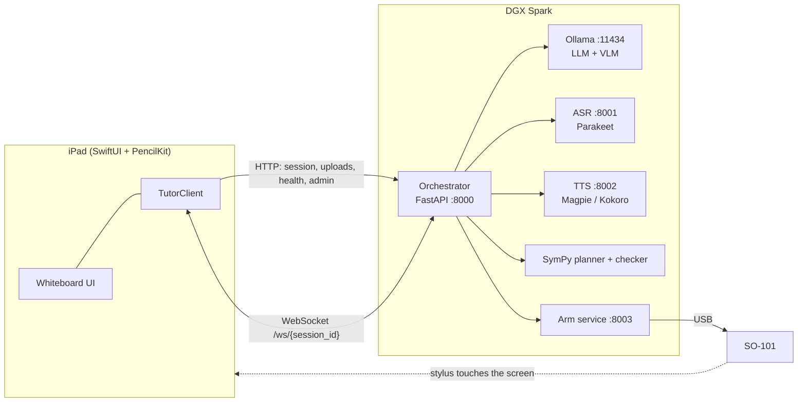
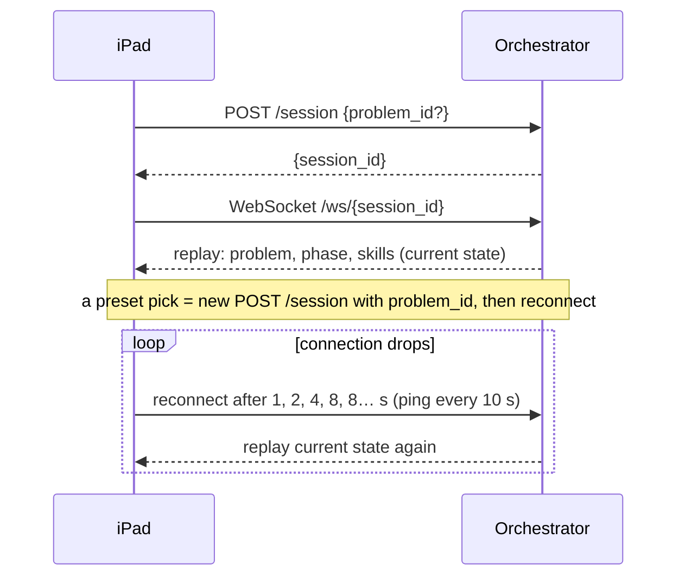
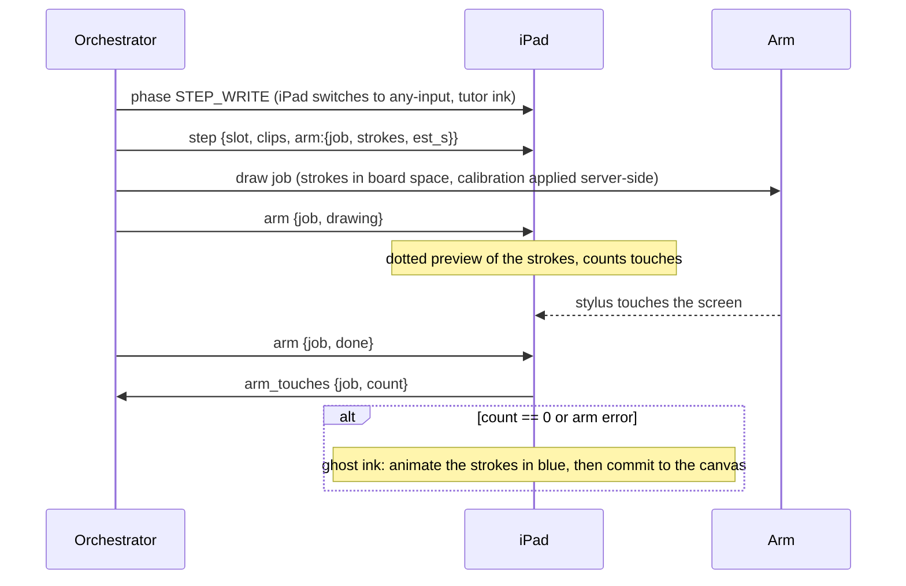

# Interface: iPad app ⇄ DGX Spark

How the SwiftUI iPad app (`ios/`) and the orchestrator on the DGX Spark (`backend/`) talk to each other, feature by feature. It is the contract both sides build and test against.

- **Product and design:** [01-plan.md](01-plan.md) (sections 3, 6 and 7), [02-architecture-and-flow.md](02-architecture-and-flow.md).
- **iPad implementation:** `ios/Packages/CacheFlowKit/Sources/CacheFlowKit/Protocol/Events.swift` (WebSocket types) and `Net/TutorAPI.swift` (HTTP requests). They are covered by unit tests; change them together with this document.
- **Status:** the iPad side is built and runs end to end against a built-in mock (`MockServer`). The Spark side is not built yet. Items marked **⚠ proposed** are the iPad's assumptions where 01-plan.md was silent. The backend owner must confirm or change them (see [Open questions](#open-questions)).

## 1. Principles

1. **The server decides, the iPad shows.** The orchestrator owns the lesson state machine, the maths (SymPy) and every tutoring decision. The iPad renders state, captures input, and reports what the student did. It never decides correctness or the next step.
2. **One port, two channels.** The iPad only talks to the orchestrator on `:8000`: REST for uploads and queries, one WebSocket per session for everything the server pushes. The iPad never calls Ollama, ASR, TTS or the arm directly.
3. **Server pushes, iPad reports.** The result of an upload is never in its HTTP response (except `/audio`'s transcript); it arrives as a WebSocket event. That keeps one ordered stream of truth for the UI.
4. **Everything is board space.** Every coordinate on the wire is in the board's coordinate system (§3), so the arm calibration, the highlights and the stroke jobs agree.
5. **Degrade, don't break.** Unknown events are ignored, missing audio falls back to on-device speech, a missing arm falls back to ghost ink, and a missing server leaves the preset picker and the UI working.

## 2. Topology



**Profiles.** The iPad has four server profiles, selected in Settings: **Mock** (in-process, no network), **MagicDNS** `http://tutor-spark:8000`, **Tailscale IP** and **LAN** (the last two are editable, defaults are placeholders). Plain HTTP is used; iOS App Transport Security is relaxed only for local-network hosts. Production access goes over Tailscale (WireGuard) or the LAN, never the public internet. The WebSocket URL is the same host with `ws://` (or `wss://` if the base URL is `https`).

## 3. Coordinates and the board

The iPad is **landscape only, full screen**, and the board never moves, scales or scrolls. `BoardLayout` (in CacheFlowKit) derives all geometry from the screen size in points. Reference device: **iPad Pro 11″ (M4), 1210 × 834 pt**.

```
┌──────────────────────────────────────────────────────────────────┐ y=0
│ header 64                                                        │
├────────────────────────────────────────┬─────────────────────────┤ y=64  ← board origin (0,0)
│ question box (own canvas)              │ tutor strip 540 wide    │
│ ────────────────────────────           │ ┌ slot 1 ─────────────┐ │
│ work area: student ink                 │ ├ slot 2 ─────────────┤ │
│ (the only area line segmentation reads)│ ├ slot 3 ─────────────┤ │
│                                        │ ├ slot 4 ─────────────┤ │
│                                        │ └ slot 5 ─────────────┘ │
├────────────────────────────────────────┴─────────────────────────┤
│ caption bar 88                                                   │
└──────────────────────────────────────────────────────────────────┘ y=834
```

| Term | Definition |
| --- | --- |
| **Board space** | Origin at the top-left of the main canvas (screen y = 64), x right, y down, units = points (1 pt = 1/132 in on an 11″ iPad). Used for every point and rectangle on the wire. |
| **Tutor strip** | Right-hand region, 540 pt wide, 5 slots of equal height. The arm only ever writes here (and, in Guide `ARM_STEP`, may write beside the student's line). |
| **Slot** | **1-based** in events (`slot` field). Step *k* is written into slot *k*. Slot rectangles are in the iPad's `BoardLayout`; the arm is calibrated to these. |
| **Line** | A row of the student's working, **0-based** (`index`, `line_index`). Lines are produced on the iPad by sorting strokes by vertical position (gap > 35 pt starts a new line). |
| **Layout fingerprint** | `"<width>x<height>"` in points, e.g. `1210x834`. Calibration data must record it and be discarded if it differs. |

⚠ **Strip width.** The plan asks for characters ≥ 80 pt tall. At that size ~10 characters fit in 540 pt; the strip is therefore wider than the "small panel" the plan sketches. Robotics must confirm the slot rectangles (they are one constant block in `BoardLayout.swift`).

## 4. Session lifecycle



- The iPad creates a session on launch and again on **New problem**, on a **preset pick** (with `problem_id`) and on **Reconnect** in Settings. One active session at a time; the server may discard the previous one.
- **State replay (required).** On every WebSocket connect the server sends `problem` (if any), `phase` and `skills` so a reconnecting or freshly created iPad shows the right screen. The replay must not re-send `step`, `ask` or audio, or the iPad would replay clips.
- If `POST /session` fails, the iPad shows "I can't reach the tutor server" and retries every 3 s; presets and the question box remain usable.

## 5. HTTP API

All bodies are UTF-8. Errors: any non-2xx is treated as failure and surfaced to the student as a plain-language caption; the body is ignored. Timeout is 15 s.

| Method & path | Request | Response | Triggered by |
| --- | --- | --- | --- |
| `POST /session` | JSON `{"problem_id": "quad_5_6"}` (field optional, body may be `{}`) | `{"session_id": "…"}` | Launch, New problem, preset, Reconnect |
| `POST /session/{id}/question` | `Content-Type: image/png`, raw body: the question box, flattened on white | `2xx`, empty. Result arrives as WebSocket `problem` (`needs_confirm: true`) + `phase` `CONFIRM`. | **Read it** |
| `POST /session/{id}/lines` | `multipart/form-data`: field `meta` = JSON `[{"index":0,"bbox":[x,y,w,h]}, …]`; one PNG file per line named `line_<index>` (each on white, 2× scale, 12 pt padding) | `2xx`, empty. The iPad then sends WebSocket `check`. Result arrives as `read_back`, `highlight`, `tutor_say`. | **Check** |
| `POST /session/{id}/audio` | `Content-Type: audio/wav`, raw 16 kHz mono 16-bit PCM | `{"transcript": "…"}`. The server **also** feeds the transcript into the state machine as an utterance, exactly as if it were `answer_text`. | Release of **Hold to talk** |
| `GET /audio/{clip}.wav` | – | A WAV (or any format `AVPlayer` plays), served from the `url` in an event | Playing a clip |
| `GET /health` | – | See below | Settings sheet (every 3 s while open) |
| `POST /admin/{action}` | JSON `{"value": "…"}` (optional) | `2xx` | Settings → Operator and Voice |

`bbox` is `[x, y, width, height]` in board space.

`/health` response (⚠ proposed shape, matches the plan's "status and latency of every dependency plus the Tailscale and LAN IPs"):

```json
{
  "services": {
    "llm": {"ok": true, "latency_ms": 180},
    "vlm": {"ok": true, "latency_ms": 420},
    "asr": {"ok": true, "latency_ms": 90},
    "tts": {"ok": true, "latency_ms": 140},
    "arm": {"ok": false, "detail": "no serial device"}
  },
  "tailscale_ip": "100.64.0.1",
  "lan_ip": "192.168.1.50"
}
```

Service keys the iPad shows, in order: `llm`, `vlm`, `asr`, `tts`, `arm`. Unknown keys are ignored; a missing key shows a grey dot.

`/admin/{action}` actions the iPad exposes: `next_problem`, `skip_step`, `force_arm_step`, `reset`, and `tts_backend` with `value` `magpie` or `kokoro`. (`ghost_mode` from the plan is a **local** iPad toggle instead; see §8.) These are operator controls: unauthenticated on the trusted network, and they must never be reachable from outside it.

**Presets.** The iPad bundles these so the picker works with the server down. The backend must accept them as `problem_id`:

| `problem_id` | Display | `kind` |
| --- | --- | --- |
| `quad_5_6` | x² + 5x + 6 = 0 | quadratic |
| `quad_7_12` | x² + 7x + 12 = 0 | quadratic |
| `quad_m5_6` | x² − 5x + 6 = 0 | quadratic |
| `lin_2_3_11` | 2x + 3 = 11 | linear |

## 6. WebSocket `/ws/{session_id}`

JSON text frames, one object per frame, discriminated by `"type"`. Unknown `type`s are ignored by the iPad (forward compatible). Fields marked optional may be omitted.

### Server → iPad

| `type` | Fields | iPad behaviour |
| --- | --- | --- |
| `problem` | `display` string, `kind` string, `needs_confirm` bool | Sets the header's "Solve:" text. If `needs_confirm`, opens the **"I read…" sheet** (✓ Looks right / Rewrite). |
| `phase` | `mode` `teach\|guide\|check`, `phase` (see §7) | Updates the phase chip and **switches the pen policy** (§7). `IDLE` resets the lesson UI. |
| `step` | `index` (1-based), `of`, `slot` (1-based), `display`, `clips[]` (`{id,url,caption}`), `arm` (optional): `{job, strokes: [[[x,y],…],…], est_s}` | Highlights slot *k*, updates "Step *k* of *n*", queues the clips (audio + captions), shows a dotted **preview** of `arm.strokes`. |
| `ask` | `clip`, `answer` `voice\|write\|either` | Plays the question clip, shows the answer field (unless `voice`) and enables push-to-talk. |
| `tutor_say` | `caption`, `url` (optional) | Shows the caption; if `url` is present, plays it. No `url` means caption only. |
| `read_back` | `lines[]`: `{index, expr, ok}` | Under each of the student's lines, shows "I read: *expr*" with a ✓ (`ok`) or ⚠. Keyed by the same `index` as the lines uploaded in `/lines`. |
| `highlight` | `line_index`, `bbox` `[x,y,w,h]` | Red rounded rectangle over `bbox`, fading after 4 s. |
| `arm` | `job`, `state` `drawing\|done\|error` | See §8. |
| `skills` | `skills`: `{name: level}` | Skill bars in the header. ⚠ Levels are integers **0–5**; known names: `factor_pair`, `signs`; others are shown capitalised. |

### iPad → server

| `type` | Fields | When |
| --- | --- | --- |
| `confirm_problem` | `ok` bool | ⚠ Tap on ✓ / Rewrite in the "I read…" sheet. |
| `choose_mode` | `mode` `teach\|guide\|check` | ⚠ **Teach me** / **Let me try** / **Spot the mistake**. |
| `audio_done` | `clip` (the clip `id`) | Each `step` and `ask` clip finishes playing. Not sent for `tutor_say`. |
| `answer_text` | `text` | Typed answer to an `ask`. |
| `check` | – | Sent after `/lines` upload succeeds. |
| `stuck` | – | **I'm stuck** (Guide). |
| `arm_touches` | `job`, `count` | After `arm` `done`: how many touches the canvas received during the job. |
| `mistake_circled` | `line_index` (0-based slot) | In `SPOT_MISTAKE`, a circle drawn over a tutor line. |
| `clear_board` | – | The eraser button. The iPad has already removed the tutor's ink; this tells the server to forget it. |

### Ordering and acknowledgement

- Frames are processed in order. Events may arrive while audio is playing; the iPad queues clips and plays them one at a time.
- `audio_done` is how the server knows the explanation has finished: for a Teach step the server waits for **both** `arm: done` **and** `audio_done` for every clip of the step before moving on.
- The iPad does not acknowledge `phase`, `problem` or `skills`.

## 7. Phases and the pen policy

The server owns the phase. The iPad maps it to input and ink so the student's palm leaves no marks and the tutor's writing is never mistaken for the student's.

| Phase | Mode | iPad shows | Canvas input | Ink |
| --- | --- | --- | --- | --- |
| `IDLE`, `POSE`, `CONFIRM`, `MODE_SELECT` | any | Question box active; **Teach me / Let me try** at `MODE_SELECT` | Pencil only | Student (black) |
| `STEP_INTRO`, `FOLLOW_UP`, `RECAP` | teach | Captions; **Spot the mistake / Let me try one** at `RECAP` | Pencil only | Student |
| `STEP_WRITE` | teach, check | Slot highlighted, dotted preview, audio | **Any** (arm stylus must register) | **Tutor (blue)** |
| `STEP_CHECK` | teach | Answer field + push-to-talk | Pencil only | Student |
| `WORKING`, `HINTING` | guide | **Check** and **I'm stuck** | Pencil only | Student |
| `ARM_STEP` | guide | Arm writes one step | **Any** | **Tutor** |
| `SPOT_MISTAKE` | check | "Circle the mistake" | **Any** | Student |
| `SOLVED`, `FINAL`, `DONE` | any | **New problem** at `SOLVED`/`DONE` | Pencil only | Student |

The server must send `phase` **before** the `step`/`arm` events of that phase, so the pen is in tutor ink when the arm starts.

## 8. The arm, touches and ghost ink

The arm is a separate process (`:8003`); the iPad never talks to it. The iPad's role: provide a surface that registers the arm's stylus, count the touches, and fall back to drawing the strokes itself.



- **Strokes** are polylines in board space inside the target slot. The backend generates them (Hershey single-line font); characters should be ≥ 80 pt tall. `est_s` is the expected drawing time and also the ghost-ink animation duration.
- **Touch counting** covers any input type (pencil, finger, pointer), on the main canvas, between `arm: drawing` and `arm: done`.
- **Ghost ink fallback** runs when `arm: error`, or `arm: done` with zero touches, or when "Always show ghost ink" is on in Settings (the demo-without-arm mode). The strokes are committed to the canvas in tutor blue, so a later "clear board" removes them like real arm ink. Jobs are independent, so several can be in flight.
- **Calibration.** A hidden long-press (1.5 s) on the "Solve:" text, or Settings → Calibration mode, shows a 3 × 3 grid of targets in the tutor strip and logs every touch (board-space position, input type, nearest target). **Export JSON** shares `{layoutFingerprint, targets, touches[]}`; the robotics owner fits the canvas→table map from it. The log is not sent to the server.

## 9. Feature → interface map

| iPad feature | Trigger | Calls | Events back | Server responsibility |
| --- | --- | --- | --- | --- |
| **Pose a problem by handwriting** | Student writes in the question box, taps **Read it** | `POST /question` (PNG) | `problem` (`needs_confirm: true`), `phase CONFIRM` | VLM transcription of the box → expression → classify (`kind`). |
| **Confirm the read-back** | Sheet: ✓ / Rewrite | WS `confirm_problem{ok}` | `phase MODE_SELECT` (ok) or `POSE` (rewrite) | Accept or discard the parsed problem. |
| **Pose by preset** | **Presets** menu | `POST /session {problem_id}` then reconnect | replay: `problem` (`needs_confirm: false`), `phase MODE_SELECT` | Look up the problem; start at `MODE_SELECT`. |
| **Teach me** | Button at `MODE_SELECT` | WS `choose_mode{teach}` | `phase`, `step`, `arm`, `ask`, `tutor_say`, `skills`, `phase RECAP` | Plan with SymPy, narrate, pre-render TTS, drive the arm, wait for `audio_done` + `arm: done`. |
| **Answer a check question** | Type + **Send**, or hold-to-talk | WS `answer_text`, or `POST /audio` | `tutor_say`, next `step` or `phase FOLLOW_UP` | Judge (numbers first, LLM fallback); two wrong answers means explain and move on. |
| **Let me try / Check** | **Let me try**, then **Check** | WS `choose_mode{guide}`; `POST /lines`; WS `check` | `phase WORKING/HINTING`, `read_back`, `highlight`, `tutor_say`, `skills` | VLM per line (parallel) → SymPy checks → first wrong line → one Socratic question (≤ 25 words, never the answer). |
| **I'm stuck** | Button | WS `stuck` | `phase` → Teach from current step | Switch to Teach at the student's step. |
| **Spot the mistake** | **Spot the mistake** at `RECAP` | WS `choose_mode{check}`; WS `mistake_circled` | `phase STEP_WRITE` → `SPOT_MISTAKE`, `step`/`arm` per line, `tutor_say`, `phase FINAL/DONE` | Write a solution with one deliberate canned mutation; judge the circled line (slot index). |
| **Voice answer (push-to-talk)** | Hold the mic button (disabled while the tutor speaks) | `POST /audio` | `tutor_say`, … | ASR (Parakeet) → state machine. Reply `{transcript}`; the iPad shows "You said: …". |
| **Tutor audio + captions** | `step`, `ask`, `tutor_say` events | `GET /audio/{clip}.wav` | `audio_done` (WS) | Pre-render TTS; serve clips. Captions are always shown. If a clip fails to load, the iPad speaks the caption on-device. |
| **Clear board** | Eraser | WS `clear_board` | – | Forget the tutor's board state. |
| **New problem** | Button at `SOLVED`/`DONE` | `POST /session` | replay | Fresh session. |
| **Skill bars** | `skills` event | – | – | Update after judged answers; integers 0–5. |
| **Settings: services** | Open Settings | `GET /health` every 3 s | – | Report each dependency and the IPs. |
| **Settings: voice** | Magpie / Kokoro | `POST /admin/tts_backend {value}` | – | Switch TTS backend behind the one `/tts` interface. |
| **Settings: operator** | Next problem, Skip step, Force arm step, Reset | `POST /admin/{action}` | usual `phase`/`step` events | Force the transition (the stage "get-out-of-jail card"). |
| **Calibration** | Hidden long-press | – (local only) | – | Consumes the exported JSON offline. |

## 10. Timing, reliability and failure behaviour

| Concern | Behaviour / target |
| --- | --- |
| **Guide turn latency** | Tap **Check** to first spoken word ≤ 3.5 s (plan target): upload lines → VLM → SymPy → LLM → first TTS sentence. The iPad immediately shows "Looking at your working…". |
| **Teach step** | No LLM wait mid-walkthrough: narration and TTS are generated before step 1 plays. |
| **WebSocket** | Ping every 10 s; reconnect with back-off 2, 4, 8, 8… s; the connection dot in the header is green / amber / red (connected / connecting / offline). State is replayed on reconnect (§4). |
| **Server unreachable** | Caption says so and retries every 3 s. The question box, presets and local ghost ink keep working. |
| **Upload fails** | Plain-language caption ("I couldn't send that…"). The student can tap again; nothing is queued silently. |
| **Audio** | Clips play one at a time. If a clip URL fails, the iPad speaks the caption with on-device TTS. The mic is blocked while the tutor speaks (half-duplex). |
| **Idempotence** | Re-tapping **Check** re-uploads and re-checks; the server should treat the latest `/lines` as authoritative for the session. |
| **Security** | Trusted network only (Tailscale or LAN). No authentication today; `/admin/*` is as exposed as the port. No student data leaves the Spark. |

## 11. Mock server

`MockServer` (CacheFlowKit) implements both the `TutorAPI` (HTTP) and `EventStream` (WebSocket) protocols in-process, so the iPad can be built, demoed and tested with no Spark. Select the **Mock** profile in Settings (the default in Debug builds). It runs the x² + 5x + 6 = 0 lesson end to end: confirm → Teach (5 steps with scribble strokes, check questions, skill bumps, recap), Guide (a canned read-back and highlight on the second line), and Spot-the-mistake (four lines written in sequence; the third is wrong). Its strokes are placeholder scribbles; its timings are shorter than real ones.

The backend owner can use `MockServer.swift` as an executable reading of this document, and the tests in `ios/Packages/CacheFlowKit/Tests` (decoding of every event, request shapes) as the contract tests.

**Debug launch argument:** `-demo teach|guide|check` (Debug builds only) picks the first preset and starts that mode automatically.

## 12. Changing this contract

1. Propose the change on the [agent board](https://github.com/Vrun1506/Cache-Flow/issues/1), tagging the iPad and backend owners.
2. Update this file, `Events.swift` / `TutorAPI.swift`, `MockServer.swift` and the tests in one change.
3. Additive changes (new optional fields, new event types) are safe: the iPad ignores unknown events and fields. Renames, removals and meaning changes need both sides to merge together.

## Open questions

| # | Question | iPad's current assumption | Owner |
| --- | --- | --- | --- |
| 1 | Exact field names for `confirm_problem`, `choose_mode`, `audio_done`, `answer_text` | `ok`, `mode`, `clip`, `text` | Backend |
| 2 | `/health` response shape | As in §5 | Backend |
| 3 | `step.index` / `slot` base, `line_index` base | Steps and slots 1-based; lines 0-based | Backend |
| 4 | Skill level range | Integers 0–5 | Backend |
| 5 | Replay-on-connect contents | `problem`, `phase`, `skills` only | Backend |
| 6 | Tutor strip width and slot rectangles | 540 pt wide, 5 equal slots (§3) | Robotics |
| 7 | Where a Guide `ARM_STEP` writes | Server chooses a free spot in board space; the iPad draws whatever strokes it is given | Backend, Robotics |
| 8 | Handwritten (vs typed) answers to check questions | Typed or spoken only; `answer_text` is text | Product |
| 9 | Authentication on `/admin/*` | None (trusted network) | Backend |
