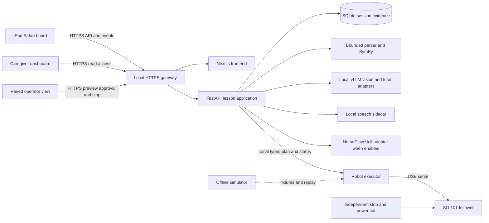

# Socrates architecture

This is the proposed single-station architecture. See [prd.md](prd.md) for product scope, [design.md](design.md) for contracts, [decisions.md](decisions.md) for tradeoffs, and [status.md](status.md) for observed progress. Product modules and paths in the inventory are planned.

## Deployment and trust boundaries

- **iPad and caregiver:** keep the existing Next.js workspace. Use responsive Canvas/SVG, Pointer Events, and an editable text equivalent. Serve the app and API through one trusted HTTPS origin on the demo LAN. HTTPS and iPad microphone permission are prerequisites for voice. Keep the desktop caregiver dashboard in the same frontend with a separate access role.
- **DGX Spark:** one FastAPI app owns lesson state and SQLite writes, and coordinates bounded calls to model and speech processes. Use NVIDIA's ARM64 vLLM container and immutable image/model revisions selected by a Spark smoke test. Start with Nemotron Nano 12B v2 VL for one cropped row, and evaluate Nemotron 3 Nano 30B A3B NVFP4 for tutor wording. Benchmark both resident before reserving their memory. Start with one resident VL model for recognition plus deterministic text hints if capacity is tight.
- **Tutor and speech:** the Socratic skill selects a question using a trusted reason code and lesson state. Run it through a local Nemotron adapter, with NemoClaw/OpenShell and NeMo Guardrails evaluated for demonstrable use. The application checks output against the lesson policy. Parakeet TDT 0.6B v3 and MagpieTTS Multilingual 357M are the selected initial ASR and TTS models in an ARM64 NeMo-Speech.cpp sidecar, subject to Spark qualification. Push-to-talk sends a completed clip for transcription.
- **Robot:** a separate local process owns the serial device, calibration, arming and motion limits. Only the executor talks to the SO-101. The API offers allowlisted annotation intents to a planner, never raw joints or arbitrary model-generated SVG. Use `lerobot-artist` as the reference for bounded, continuous vector paths and LeRobot for SO-101 integration. Evaluate an Isaac Sim/Lab twin via LeIsaac for trajectory and clearance visualisation, with a validated compatible version pair and the simulator disconnected from the serial device. Real-world safety and accuracy still require bench tests.
- **Network and data:** inference, speech, and robot endpoints are local-only. Pair student, caregiver, and operator roles with short-lived, scoped sessions. Check origin and authorization for mutations and event subscriptions. Keep OpenShell's network policy limited to the required local endpoints. Store calibration separately from learner data. Store evidence and summaries on the Spark with session-scoped access. Keep raw audio and rasterized handwriting transient, with no external analytics or learner content in GitHub.

## Flow and ownership

1. The board owns a draft of each row. A submission freezes its row ID and revision. The API validates its size, rasterizes strokes for vision or transcribes the bounded audio clip, and returns an editable candidate. Typed input can go directly to confirmation.
2. The confirmed candidate enters the bounded maths parser. A lesson strategy compares the factor coefficients or complete real root set with the curated problem. In one SQLite transaction the app stores the result, current state and sequence number. A failed or late result cannot advance a newer revision.
3. The application turns checker evidence into Mistake Glow and a question. It validates the optional model question before rendering and sending the same text to TTS. A template covers inference, policy or speech failures. The maths result is available before the question or audio completes.
4. If an annotation needs motion, the application publishes the planner's immutable preview. The app confirms display and the operator approves that exact version. The executor rechecks revision, calibration, arming, limits, heartbeat and plan expiry immediately before movement. Its status drives the UI. The lesson uses a digital annotation if a motion job is unavailable or rejected.
5. Accepted attempts record skill evidence. The transfer check and final summary commit together so a reconnect cannot count the same attempt twice. The dashboard fetches a summary with separate authorization.

## Component inventory and extension review

Planned directories below name ownership and extension seams. The verdict for each row is pending implementation and the listed check. Exercise representative substitutes through the composition boundary, then review the diff for changes outside the designated extension point.

| Component / owner | Contract and variation | Extension seam and stable policy | Required evidence |
| --- | --- | --- | --- |
| C1 · Board and dashboard · `frontend/` | Draft rows and confirmed submissions, sequenced view state, caregiver summary. Pointer input, typing and voice share one confirmation flow. | Input adapters feed a board reducer. Rendering layers consume the same annotations and preview coordinates. Keep the reducer and request contract stable. | Replay the golden session with typed and Pencil fixtures. Confirm a stale event cannot change the displayed row. Test caregiver access and visual/audio equivalents. |
| C2 · HTTP, pairing and orchestration · `backend/` | Versioned sessions, role-scoped API and events, ordered lesson transitions. | FastAPI is an adapter over a focused application service. Inject providers in the startup composition root. Keep pairing, idempotency and state transitions in the app. | Inject fake provider and simulated executor together. Replay retries, cross-role requests and disconnect through real routes. |
| C3 · Maths and curriculum · `backend/` | `check(problem, task, candidate) → CheckResult`. Factor and root checks share a bounded AST and evidence format. | Strategy selected by task in the lesson definition. Keep parser limits and session transition policy stable. | Factor and root strategies pass the same verdict/evidence contract. Test signs, roots, unsupported inputs and a fixture strategy without UI edits. |
| C4 · Recognition and speech · `backend/` | `recognize(row)` or `transcribe(clip)` returns editable candidates. `speak(text)` returns bounded audio. | Inject separate vision, ASR and TTS adapters. Keep recognition separate from evaluation. | Compare fake and live adapters against fixture inputs. Verify timeout, empty response, mic denial and silent text fallback. |
| C5 · Socratic policy · `backend/` | `hint(evidence, lessonState) → Hint`. Return one question for a known reason. | Policy and templates stay in the app. A local model or sandboxed skill can propose wording through the same adapter. | Try deterministic, direct vLLM, and sandboxed providers through the same policy. Reject answer leakage, extra questions, and invalid schemas. |
| C6 · Session evidence and summary · `backend/` | Atomic attempt/evidence/event commit and authorized summary view. | Direct SQLite implementation for one station. Version migrations and keep SQL inside the repository module. | Restart mid-transaction. Verify recovery, idempotent duplicate submission, authorization and deletion. |
| C7 · Motion planner and executor · `robotics/` | Versioned geometry preview, explicit approval, local motion state and stop. | Small allowlist for geometry. Simulated and SO-101 drivers use the same executor. Keep arming, limits and watchdog outside drivers and model output. | Replay a circle and glyph plan on simulated driver. Verify real stop path, no duplicate move, and hard rejection of stale and out-of-bounds plans. |
| C8 · Calibration and offline twin · `robotics/` | Versioned fixture profile and offline replay of approved plan samples. | Direct fixture profile validation with a separate offline replay adapter. Runtime executor keeps authority. | Measure holdout points, invalidate moved fixtures, replay paths and compare measured paper traces. |

The GitHub agent board remains a development coordination tool. It has no link to learner data or robot execution.

## Speech stack

- **Speech recognition:** [Parakeet TDT 0.6B v3](https://huggingface.co/nvidia/parakeet-tdt-0.6b-v3), initially `parakeet-tdt-0.6b-v3.q8_0.gguf`. In NeMo-Speech.cpp this model uses full-utterance recognition after push-to-talk release, not cache-aware streaming. [NVIDIA ASR model documentation](https://github.com/NVIDIA/NeMo-Speech.cpp/blob/main/docs/asr/models.md).
- **Tutor voice:** [MagpieTTS Multilingual 357M](https://huggingface.co/nvidia/magpie_tts_multilingual_357m) with NeMo NanoCodec. Its model card specifies the NVIDIA Open Model License. [NVIDIA's ARM64 container guide](https://catalog.ngc.nvidia.com/orgs/nvidia/-/containers/nemo-speech.cpp/-?_lr=1) lists the model, codec, and tokenizer assets separately.
- **Runtime:** start qualification with NVIDIA NeMo-Speech.cpp container `nvcr.io/nvidia/nemo-speech.cpp:0.2.0`, with models prepared locally and served over loopback. Upstream documents ARM64, Parakeet and Magpie support. Confirm this exact container, model revisions, licenses, device and CUDA combination on the team's Spark before calling it working or pinning for deployment.
- **Fallback:** retain captions and typed entry. [Kokoro-82M](https://huggingface.co/hexgrad/Kokoro-82M) is an optional local TTS fallback after a separate ARM64 and latency test.

## Operating targets

- One active learner session and one physical station. Bound the API to one pending recognition/check per session and the executor to one pending or active plan. Return an explicit busy response instead of allowing an unbounded queue. Limit input sizes and model tokens as described in [design.md](design.md).
- Use the [PRD's latency targets](prd.md#pilot-gates-and-measures). Measure end-to-end and per-stage timings, warm/cold behavior, shared GPU memory, rejected paths, and fault-to-stop times. Log event IDs, durations and reason codes with payloads excluded.
- Prefer a documented demo mode over an automatic swap to cloud inference. If a provider fails, select typed input, text hints, or digital drawing. Store no learner data in the simulator. Snapshot DB schema before migrations, retain a bounded local backup for authorized pilot data, and verify session deletion before using real data.
- No benchmark or hardware pass is established by this design. Revisit a multi-worker database, additional GPUs, and independent frontend/backend deployment when measured workload justifies them.

## Stack references

- iPad input and secure mic context. [W3C Pointer Events](https://www.w3.org/TR/pointerevents3/), [Media Capture and Streams](https://www.w3.org/TR/mediacapture-streams/)
- Spark inference and model candidates. [NVIDIA vLLM container release notes](https://docs.nvidia.com/deeplearning/frameworks/pdf/vLLM-Release-Notes.pdf), [Nemotron Nano VL Spark recipe](https://github.com/vllm-project/recipes/blob/main/NVIDIA/Nemotron-Nano-12B-v2-VL.md), [Nemotron 3 Nano NVFP4 model card](https://huggingface.co/nvidia/NVIDIA-Nemotron-3-Nano-30B-A3B-NVFP4)
- Local runtime and speech. [NemoClaw inference provider choices](https://docs.nvidia.com/nemoclaw/latest/user-guide/deepagents/inference/learn-and-choose/choose-inference-provider), [OpenShell network policy](https://docs.nvidia.com/nemoclaw/latest/user-guide/openclaw/network-policy/customize-network-policy), [NeMo Guardrails](https://docs.nvidia.com/nemo-guardrails/), [NeMo-Speech.cpp models](https://github.com/NVIDIA/NeMo-Speech.cpp), [ARM64 speech container](https://catalog.ngc.nvidia.com/orgs/nvidia/-/containers/nemo-speech.cpp)
- Maths and motion. [SymPy solving guide](https://docs.sympy.org/latest/guides/solving/solving-guidance.html), [LeRobot SO-101](https://github.com/huggingface/lerobot/blob/main/docs/source/so101.mdx), [lerobot-artist](https://github.com/sorob/lerobot-artist), [LeIsaac](https://github.com/LightwheelAI/leisaac), [Isaac Sim Spark requirements](https://docs.isaacsim.omniverse.nvidia.com/latest/installation/requirements.html)
